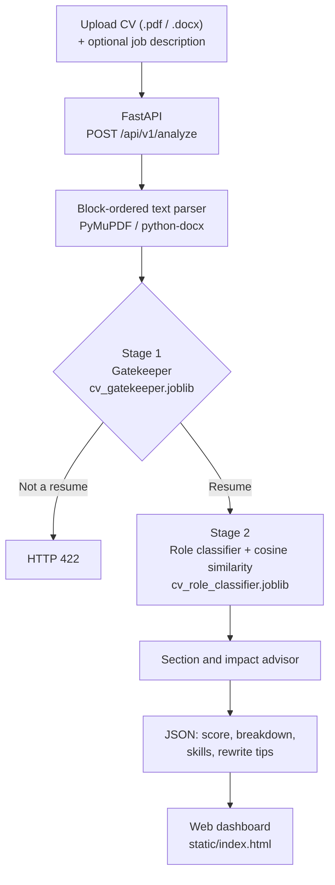

<div align="center">

# AI CV Analyzer

**ATS scoring, role classification and job-fit analysis for resumes, powered by a custom two-stage ML pipeline.**

[](https://www.python.org/)
[](https://fastapi.tiangolo.com/)
[](https://scikit-learn.org/)
[](https://ai-cv-analyzer.onrender.com)

[Live Demo](https://ai-cv-analyzer.onrender.com) · [API Docs](https://ai-cv-analyzer.onrender.com/docs) · [Report a Bug](../../issues)

</div>

---

## Overview

AI CV Analyzer accepts a resume (`.pdf` or `.docx`) and an optional job description, then returns an ATS-style score, the candidate's detected role, a skill-gap breakdown, and concrete rewrite suggestions.

Before any scoring happens, a trained gatekeeper model rejects documents that are not resumes (exam papers, invoices, lecture notes, articles), so results are only produced for real CVs.

## Features

| Capability | Description |
|---|---|
| **Document gatekeeper** | `LogisticRegression` + TF-IDF binary classifier that rejects non-resume uploads with HTTP `422`. |
| **Role classification** | Calibrated `LinearSVC` + TF-IDF model that maps a resume to AI/ML Engineer, Backend Engineer, Frontend Developer, Data Analyst/Engineer, or DevOps/Cloud Engineer, with calibrated confidence. |
| **Job-description matching** | TF-IDF cosine similarity between the CV and the target job, plus matched skills and missing keywords. |
| **Section-aware diagnostics** | Parses Experience, Projects, Skills and Education blocks and flags skills that are listed without project evidence. |
| **Bullet-point advisor** | Detects weak or passive phrasing ("Worked on...", "Responsible for...") and suggests quantified, action-verb rewrites based on the candidate's stack. |
| **Interactive dashboard** | Drag-and-drop upload, one-click role presets, severity filters, copyable tips, and print-ready PDF export. |

## How It Works



## Project Structure

```text
cv-analyzer/
├── backend/
│   ├── app/
│   │   ├── core/
│   │   │   └── parser.py          # Block-ordered PDF and DOCX text extraction
│   │   ├── ml/
│   │   │   └── analyzer.py        # Two-stage inference and bullet rewrite advisor
│   │   ├── schemas/
│   │   │   └── response.py        # Pydantic response contracts
│   │   └── main.py                # FastAPI app, model loading, static UI mount
│   ├── static/
│   │   └── index.html             # Frontend dashboard (HTML/CSS/JS)
│   ├── training/
│   │   └── train_model.py         # Model training and evaluation
│   ├── weights/
│   │   ├── cv_gatekeeper.joblib       # Resume vs. non-resume classifier
│   │   └── cv_role_classifier.joblib  # Multi-class role classifier
│   └── requirements.txt
├── README.md
└── .gitignore
```

## Getting Started

### Prerequisites

- Python 3.11+
- Git

### Installation

```bash
# 1. Clone the repository
git clone https://github.com/danu-codes/ai-cv-analyzer.git
cd ai-cv-analyzer/backend

# 2. Create a virtual environment
python -m venv venv
```

Activate it:

```powershell
# Windows (PowerShell)
.\venv\Scripts\Activate.ps1
```

```bash
# macOS / Linux
source venv/bin/activate
```

```bash
# 3. Install dependencies
pip install -r requirements.txt

# 4. Start the server
uvicorn app.main:app --reload
```

Open <http://127.0.0.1:8000> for the dashboard or <http://127.0.0.1:8000/docs> for the interactive Swagger UI.

### Retraining the Models

Pre-trained weights are already included in `backend/weights/`. To retrain from scratch:

```bash
python training/train_model.py
```

## API Reference

| Method | Endpoint | Description |
|---|---|---|
| `GET` | `/` | Serves the web dashboard. |
| `GET` | `/api/v1/health` | Confirms the server is running and the model weights are loaded. |
| `POST` | `/api/v1/analyze` | Analyzes a resume and returns score, skill gaps and recommendations. |

### `POST /api/v1/analyze`

**Request:** `multipart/form-data`

| Field | Type | Required | Notes |
|---|---|---|---|
| `file` | file | Yes | `.pdf` or `.docx`, up to 5 MB. |
| `job_description` | string | No | Enables similarity scoring and keyword-gap analysis. |

**Example**

```bash
curl -X POST https://ai-cv-analyzer.onrender.com/api/v1/analyze \
  -F "file=@resume.pdf" \
  -F "job_description=Backend engineer with Python, FastAPI and PostgreSQL"
```

**Response shape** (values are illustrative)

```json
{
  "overall_score": 72,
  "score_breakdown": {
    "skills_match": 68,
    "impact_and_metrics": 55,
    "formatting_and_sections": 90
  },
  "extracted_profile": {
    "detected_role": "Backend Engineer",
    "matched_skills": ["Python", "FastAPI"],
    "missing_skills": ["PostgreSQL", "Redis"]
  },
  "suggested_changes": [
    {
      "severity": "high",
      "section": "Experience",
      "issue": "Passive phrasing weakens impact",
      "original_text": "Worked on backend APIs",
      "recommendation": "Rewrite with an action verb and a measurable result."
    }
  ]
}
```

**Errors**

| Status | Meaning |
|---|---|
| `422` | The document was rejected by the gatekeeper (not a resume) or failed validation. |

## Tech Stack

| Layer | Tools |
|---|---|
| Backend | Python 3.11, FastAPI, Uvicorn, Pydantic |
| Machine learning | scikit-learn (TF-IDF, calibrated LinearSVC, Logistic Regression), NumPy, Pandas, Joblib |
| Document parsing | PyMuPDF (`fitz`), python-docx |
| Frontend | HTML5, CSS3, vanilla JavaScript (Fetch API, drag-and-drop, SVG gauge) |
| Deployment | GitHub, Render |

## Deployment

The app is deployed on [Render](https://render.com). Use these settings for a new web service:

| Setting | Value |
|---|---|
| Root directory | `backend` |
| Build command | `pip install -r requirements.txt` |
| Start command | `uvicorn app.main:app --host 0.0.0.0 --port $PORT` |

[Click here to visit live website](https://ai-cv-analyzer-sb3p.onrender.com) 

> Free-tier instances on Render sleep when idle, so the first request after inactivity can take a while to respond.

## Roadmap

- [ ] Support additional role families beyond the five current domains
- [ ] Multi-language resume support
- [ ] Side-by-side comparison of multiple resumes against one job description
- [ ] Downloadable annotated resume

## Contributing

Issues and pull requests are welcome. For larger changes, please open an issue first to discuss what you would like to change.

## License

Add a license file (for example MIT) and reference it here.